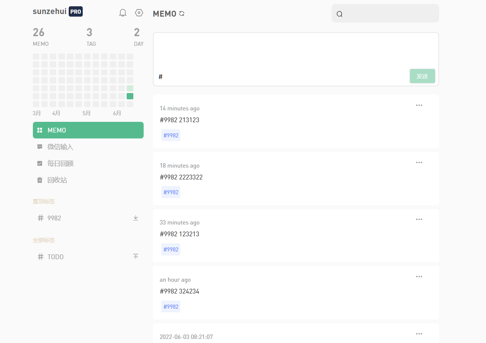

# vue3-flomo ✍️

持续不断记录，意义自然浮现 —— 浮墨

使用：Vue3 + Vite + TypeScript + Element Plus + Tailwind CSS

> 关联后端：[sunzehui/nestjs-flomo](https://github.com/sunzehui/nestjs-flomo)

支持：

- 发布 memo / 删除 memo / 回收站
- 标签筛选、标签置顶与重命名
- 登录 / 注册 / 个人主页分享
- 图片上传
- 每日回顾与热力图

## Preview



## 环境要求

- Node.js >= 18

## 本地开发

1. 确保后端已启动（默认 http://localhost:3000）

2. 安装依赖

```bash
npm install
```

3. 配置环境变量

```bash
cp .env.example .env
cp .env.development.example .env.development
```

> ⚠️ `VITE_API_URL` 必须**留空**。请求统一走 `/api` 前缀，由 vite dev server 代理到 `VITE_PROXY_TARGET`；
> 如果把它写成 `http://localhost:3000`，请求会绕过代理直连后端并带上多余的 `/api` 前缀，导致接口全部 404。

4. 启动

```bash
npm run dev
```

默认地址 http://localhost:8080

5. 构建

```bash
npm run build
```

## 常用脚本

| 命令 | 说明 |
| --- | --- |
| `npm run dev` | 启动开发服务器（含 `/api` 代理） |
| `npm run build` | 生产构建 |
| `npm run preview` | 预览构建产物 |
| `npm run typecheck` | `vue-tsc` 类型检查 |
| `npm run lint` | ESLint 检查 |

## 部署

### 静态托管（Vercel / Netlify）

仓库根目录已包含 `vercel.json` 与 `netlify.toml`，均配置了 SPA 回退到 `index.html`。
注意后端需要单独部署，并把 `/api` 反向代理到后端地址。

### Docker

```bash
docker build -t flomo-website:v0.1 .
```

镜像内使用 nginx 托管 `dist`。配合后端仓库的 `docker-compose.yaml` 使用时会自动挂载 `vhosts.conf`（含 `/api` 反向代理）。
